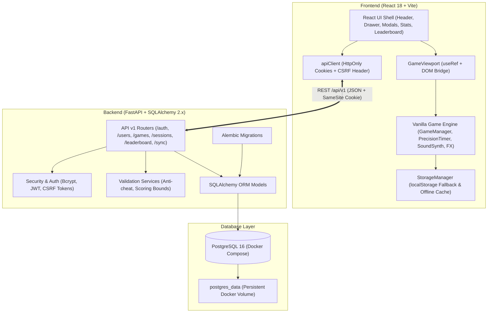

# Chemsha Bongo Architecture Guide

Chemsha Bongo is a full-stack mindful cognitive training platform combining a high-performance 60fps browser game engine, a React component shell, and a Python/FastAPI backend with a PostgreSQL database.

## System Architecture

## Core Design Principles

1. **Decoupled Game Loop (Zero GC Jank)**:
   The 60fps mini-game engine (`requestAnimationFrame`, Web Audio `AudioContext`, Canvas particles) is strictly decoupled from React's virtual DOM diffing cycle using the `GameViewport` `useRef` bridge. React renders the screens, modals, and leaderboards, while the active mini-game renders natively into a dedicated DOM container.

2. **Dual Authentication Transport**:
   - **HttpOnly, Secure-in-production, SameSite Cookies**: Default transport for web browsers, preventing XSS credential theft. State-changing requests (`POST`, `PUT`, `PATCH`, `DELETE`) require a cryptographically signed `X-CSRF-Token` header.
   - **Bearer Header**: Fully supported for automated API testing, CLI tools, and future native mobile applications.

3. **Anti-Cheat Scoring Bounds & Verification**:
   The backend does not blindly accept client scores. Game sessions are validated against theoretical score rates (max points per second), duration matching, correct vs. streak bounds, and idempotent client session IDs.

4. **Offline Continuity & Non-Destructive Data Ingestion**:
   Unregistered players or offline devices operate smoothly via `StorageManager` in `localStorage`. Upon logging in, players are prompted to merge local guest scores via `/api/v1/sync/migrate-local` with `max(server, local)` deterministic conflict resolution.

