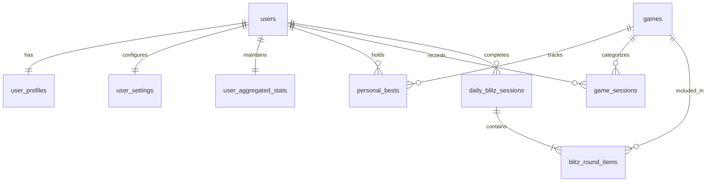

# Chemsha Bongo Database Specification

The database is built on PostgreSQL 16, orchestrated with SQLAlchemy 2.x declarative models and Alembic migrations.

## Entity Relationship Diagram (ERD)

## Table Definitions

### 1. `users`
* `id` (`UUID`, PK): User identity identifier.
* `email` (`VARCHAR(255)`, UNIQUE, NOT NULL): Lowercased user email address.
* `username` (`VARCHAR(50)`, UNIQUE, NOT NULL): Alphanumeric handle.
* `hashed_password` (`VARCHAR(255)`, NOT NULL): Salted bcrypt hash.
* `is_active` (`BOOLEAN`, DEFAULT TRUE): Account status.
* `is_verified` (`BOOLEAN`, DEFAULT FALSE): Email verification status.
* `created_at`, `updated_at` (`TIMESTAMPTZ`): Audit timestamps.

### 2. `user_profiles`
* `user_id` (`UUID`, PK, FK -> `users.id` ON DELETE CASCADE): Profile identity.
* `surname` (`VARCHAR(100)`, DEFAULT ''): Player surname / display label.
* `display_name` (`VARCHAR(100)`, NULLABLE): Optional screen name.
* `avatar_color` (`VARCHAR(7)`, DEFAULT '#1e3a34'): Japandi hex color code.

### 3. `user_settings`
* `user_id` (`UUID`, PK, FK -> `users.id` ON DELETE CASCADE): Settings identity.
* `sound_muted` (`BOOLEAN`, DEFAULT FALSE): Master audio mute.
* `haptics_enabled` (`BOOLEAN`, DEFAULT TRUE): Mobile vibration feedback.
* `ambient_enabled` (`BOOLEAN`, DEFAULT FALSE): Meditative drone state.

### 4. `user_aggregated_stats`
* `user_id` (`UUID`, PK, FK -> `users.id` ON DELETE CASCADE): Aggregations.
* `total_games_played` (`INT`, DEFAULT 0): All-time completed exercises.
* `total_correct` (`INT`, DEFAULT 0): Sum of accurate answers.
* `total_wrong` (`INT`, DEFAULT 0): Sum of correction events.
* `highest_overall_streak` (`INT`, DEFAULT 0): Best combo across all games.
* `blitz_workouts_completed` (`INT`, DEFAULT 0): Total completed 3-game circuits.
* `best_blitz_score` (`INT`, DEFAULT 0): All-time high Blitz score.
* `best_blitz_rating` (`VARCHAR(50)`, DEFAULT 'Novice'): Top achieved rank.

### 5. `games`
* `id` (`VARCHAR(50)`, PK): Canonical game identifier (`color-clash`, `chimp-memory`, etc.).
* `title` (`VARCHAR(100)`): Display title.
* `subtitle` (`VARCHAR(100)`): Pillar subtitle.
* `category` (`VARCHAR(50)`): Focus classification.
* `category_label` (`VARCHAR(100)`): Full category title.
* `icon` (`VARCHAR(10)`): Visual emoji glyph.
* `color_accent` (`VARCHAR(10)`): Accent hex color.
* `is_active` (`BOOLEAN`, DEFAULT TRUE): Catalog visibility.

### 6. `personal_bests`
* `(user_id, game_id)` (Composite PK): High score cache.
* `high_score` (`INT`, DEFAULT 0): Player record score.
* `best_streak` (`INT`, DEFAULT 0): Player record combo streak.
* `achieved_at` (`TIMESTAMPTZ`): Record achievement timestamp.
* **Index**: `(game_id, high_score DESC)` for O(1) leaderboard retrieval.

### 7. `game_sessions`
* `id` (`UUID`, PK): Session record identifier.
* `user_id` (`UUID`, FK -> `users.id`): Playing user.
* `game_id` (`VARCHAR(50)`, FK -> `games.id`): Mini-game played.
* `mode` (`VARCHAR(20)`): `'free-play'` or `'blitz'`.
* `score`, `max_streak`, `correct_count`, `wrong_count`, `accuracy_pct`: Verified metrics.
* `duration_sec` (`INT`, DEFAULT 30): Target session duration.
* `client_session_id` (`VARCHAR(64)`, UNIQUE): Deduplication UUID.
* `is_flagged` (`BOOLEAN`, DEFAULT FALSE): Anti-cheat indicator.
* `played_at` (`TIMESTAMPTZ`): Session completion timestamp.

### 8. `daily_blitz_sessions` & `blitz_round_items`
* Stores 3-game workout sessions with individual round breakdown (`score`, `accuracy_pct`, `max_streak`).
* Unique `client_session_id` guarantees idempotent submission.
* Daily leaderboard selects the single highest qualifying score per player for the target date.

